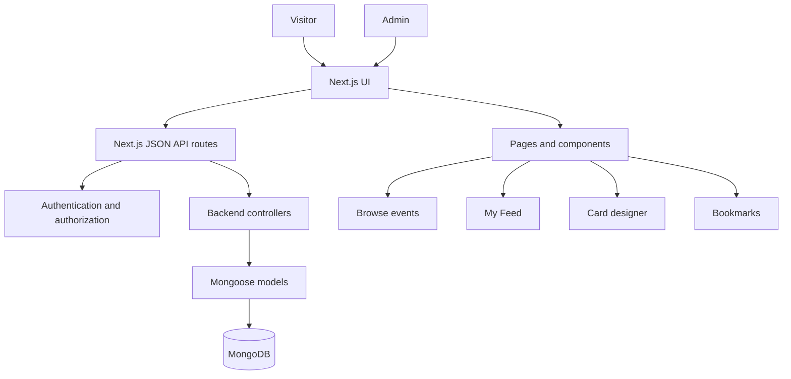
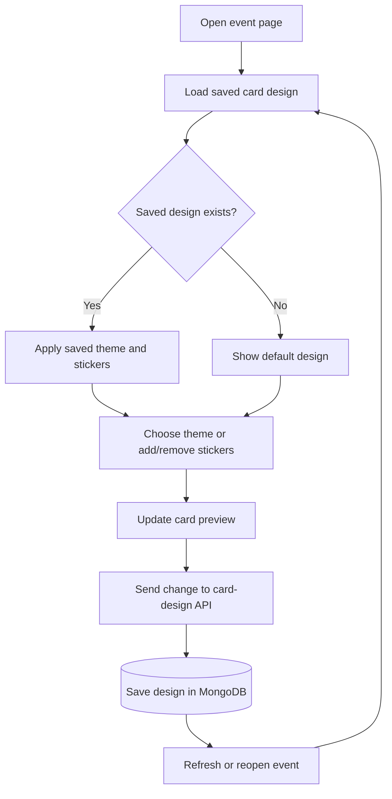
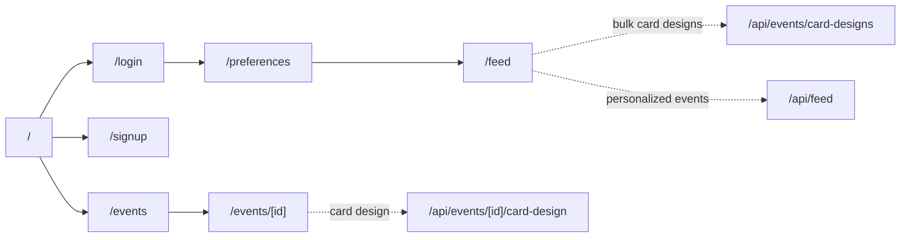

# Gather — Community Events Board

Discover local events, find something worth attending, and make each event card your own.

Gather is a community events board where an **admin publishes events** and **visitors discover the events they care about**. Browse by category, find events in your city, bookmark events for later, and personalize an event card with themes and stickers.

## What you can do

| Admin | Visitors |
|---|---|
| Create events with details, date, price, description, and image | Browse upcoming events |
| Choose from Music, Workshop, Food, Sports, and Kids categories | Filter events by category, city, and search text |
| Set events as active or inactive | Sign up and log in |
| Manage events without deleting them | Choose favourite categories and get a personalized feed |
| | Bookmark events to keep track of them |
| | Customize event cards with themes and stickers |

## Tech stack

| Technology | Used for |
|---|---|
| Next.js App Router | Pages, layouts, and API routes |
| React | Interactive UI |
| TypeScript | Type-safe application code |
| Tailwind CSS | Styling and responsive layouts |
| MongoDB | Persistent application data |
| Mongoose | MongoDB models and queries |
| Axios | Calling the application's JSON APIs |
| Lucide React | Icons |

## How the app fits together



## How card design works

Each card design is saved for a particular **user and event**. The user can switch between three themes and select up to three stickers from the five available options. Changes appear in the UI and are saved through the card-design API.



### Card-design rules

- **3 themes** to choose from.
- **5 stickers**: music, confetti, star, heart, and sparkles.
- A maximum of **3 stickers** on a card.
- Saved choices are restored when the user returns to the event.

## Main page and API routes

The pages use the application's own JSON APIs, keeping the backend reusable by other clients in the future.



> Route names above describe the routes used during development. Keep this diagram in sync with the final routes in `app/`.

## Project setup

The repository will include a setup script so a fresh clone can be prepared with one command.

```bash
git clone <YOUR_REPOSITORY_URL>
cd community-event-boards
chmod +x setup.sh
./setup.sh
```

The setup script is intended to:

1. Check that Node.js and npm are available.
2. Install project dependencies.
3. Create `.env.local` from `.env.example` if it does not already exist.
4. Prompt for any required local secrets or database configuration that cannot safely be generated automatically.
5. Print the command to start the application.

Then run:

```bash
npm run dev
```

Open [http://localhost:3000](http://localhost:3000).

**Setup note:** `setup.sh` and `.env.example` must be committed to the repository for the one-command setup to work. The script should never overwrite an existing `.env.local` or print secrets. Add the actual required environment variable names to `.env.example` based on the application code.

## Environment variables

The exact variables depend on the implementation. Keep their names in `.env.example` and their local values in `.env.local`. Typical values may include the MongoDB connection string and JWT secret; use the names expected by the project code.

Never commit `.env.local`, database credentials, or real secrets.

## Development

```bash
npm run dev
```

Before submitting, verify the API responses, authentication and authorization, event filtering and pagination, bookmarks, personalized feed, and saved card designs. Add any additional development commands that exist in `package.json`.

## AI assistance

AI tools were used to assist with development and documentation. Review the final implementation and update this note to accurately describe the assistance used.
